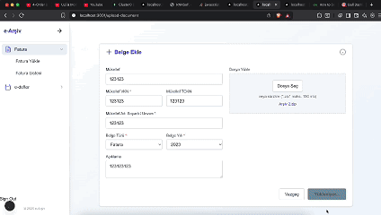

# YMM Invoice App

A Next.js app for uploading Turkish e-invoices (e-Fatura, UBL XML) in bulk. You upload one ZIP archive of XML invoices for a taxpayer (mükellef), and background workers unpack it, parse each invoice and store the key fields in MongoDB. You can then search the invoices and open any one of them in its official layout.

## What it does

- Takes a ZIP of UBL XML invoices plus taxpayer details (name, VKN, TCKN, full name), document type and year. Each upload is stored as a `Document` linked to that taxpayer and the signed-in user.
- Parses each XML file for its UUID, invoice number, issue date, type code, currency, supplier and customer names and tax numbers, and the totals (tax-exclusive, tax, tax-inclusive, discount, payable).
- Groups invoices by document type, year and taxpayer. Lists documents with search (taxpayer, description, year) and pagination.
- Lists the invoices inside a document with search (invoice number, supplier, customer, tax numbers), a filter by invoice type code, sorting by issue date and pagination.
- Shows a single invoice by applying the XSLT stylesheet embedded in the XML, in the browser, and lets you save that view as a PDF (`react-to-pdf`).
- Shows a live progress bar while an upload is processed.
- Email and password sign-up and login.

## Demo



## How it works

1. `POST /api/document/create-document` takes the multipart form with `formidable`, saves the ZIP to `uploads/faturalar/temp`, creates the `Mukellef` and `Document` records (`uploadCompleted: false`) and adds a job to the `document-processing` queue. If the job cannot be queued, the document is deleted again.
2. `workers/documentWorker.js` opens the ZIP with `adm-zip` and skips folders, non-XML files and macOS `__MACOSX` / `._` entries. It sets two Redis counters, `doc:<id>:total` and `doc:<id>:processed`, writes each XML to disk and adds one `process-invoice` job per file to the `invoice-processing` queue.
3. `workers/invoiceWorker.js` parses the XML with `xml2js` (`functions/util/extractFromXML.js` strips namespaces and reads the UBL fields), creates the `Invoice` row, renames the file to `<invoiceId>.xml` and increments the `processed` counter. When `processed` equals `total`, it sets `uploadCompleted: true` on the document and deletes the counters.
4. The upload page polls `GET /api/document-progress/<id>` every 2 seconds. The route returns the percentage from the Redis counters. Once the counters are gone, it reads `uploadCompleted` from the database instead.
5. `GET /api/invoice/view-invoice?filename=<id>.xml` returns the stored XML, which the viewer page renders with its embedded XSLT.
6. `bull-board.js` is a small Express server that shows both queues in Bull Board at `/admin/queues`.

Retries: the invoice worker is configured with `attempts: 3` and exponential backoff (2 s). After the final attempt it writes a `failedInvoice` record (document id, file name, error message) and deletes the file. See the limitations below: as written, neither part takes effect yet.

Auth: NextAuth with a credentials provider and JWT sessions. The provider calls the app's own `/api/auth/login` route, which checks the password against a bcrypt hash. `middleware.js` sends signed-out users to `/login` and passes the user id to API routes in an `x-user-id` header.

## Stack

- Next.js 15 (App Router for pages, `pages/api` for API routes), React 18, Tailwind CSS 4
- BullMQ 5 and Redis (ioredis), Bull Board with Express
- Prisma 6 with MongoDB (Atlas or local)
- NextAuth 4 (credentials, JWT), bcryptjs, yup
- adm-zip, formidable, xml2js, react-to-pdf

## Data model

Defined in `app/prisma/schema.prisma`:

- `User`: email, bcrypt password hash, has many documents.
- `Mukellef`: taxpayer name, VKN, TCKN, full name.
- `Document`: one upload. Type, year, description, `uploadCompleted`, linked to a user and a taxpayer.
- `Invoice`: the parsed fields listed above, `uuid` is unique, deleted when its document is deleted.

## Run locally

You need Node.js 20.6 or later, a MongoDB database (Atlas, or a local replica set, which Prisma needs for MongoDB) and Redis.

Create `app/.env` with these variables (names taken from the code):

```
DATABASE_URL=          # MongoDB connection string
REDIS_HOST=
REDIS_PORT=
NEXTAUTH_SECRET=
NEXT_PUBLIC_API_URL=http://localhost:3001/api
```

Then, from the `app` folder:

```bash
npm install
npx prisma generate
npx prisma db push
npm run dev                                         # Next.js on http://localhost:3001
node --env-file=.env workers/documentWorker.js      # separate terminal
node --env-file=.env workers/invoiceWorker.js       # separate terminal
node --env-file=.env bull-board.js                  # http://localhost:3000/admin/queues
```

The workers and Bull Board are plain Node scripts and do not load `.env` on their own, hence `--env-file`. Bull Board listens on port 3000, although its log line prints 3001.

## Project structure

```
app/
  app/                 pages: login, register, upload-document, list-documents, view-invoice
  components/          upload progress bar
  pages/api/           auth, document, invoice and document-progress routes
  lib/                 Prisma client, Redis connection, BullMQ queues
  workers/             documentWorker.js (unzip), invoiceWorker.js (parse and save)
  functions/util/      XML parsing, XSLT rendering, password hashing
  prisma/schema.prisma
  bull-board.js
  uploads/             stored XML files (git-ignored)
```

## Limitations and next steps

- Retries do not run yet. `attempts` and `backoff` are passed to the `Worker`, but BullMQ reads them from job options, so they should move to `invoiceQueue.add(...)` or the queue's `defaultJobOptions`.
- The schema has no `FailedInvoice` model, so `prisma.failedInvoice.create` would fail. The model needs to be added, and the progress counter should count failed files so a document with a bad file can still finish.
- The document worker calls `job.waitUntilFinished()` without a `QueueEvents` instance before deleting the ZIP, so the temporary ZIP may not be removed.
- Only invoices (`FATURA`) are supported. Dispatch notes (irsaliye) appear in the form but are disabled, and the document type is always saved as `FATURA`.
- Files are stored on the local disk, so the API and workers must share one machine. Object storage would remove that.
- `view-invoice` and `get-invoices` do not check that the invoice or document belongs to the signed-in user.
- Each upload creates a new `Mukellef` record. The same taxpayer is not reused across uploads.
- The home page is still the default Next.js starter page. There are no tests.
